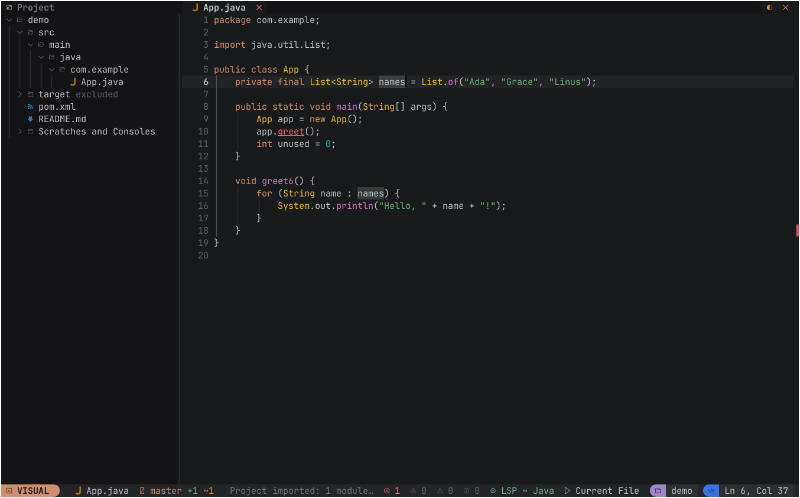
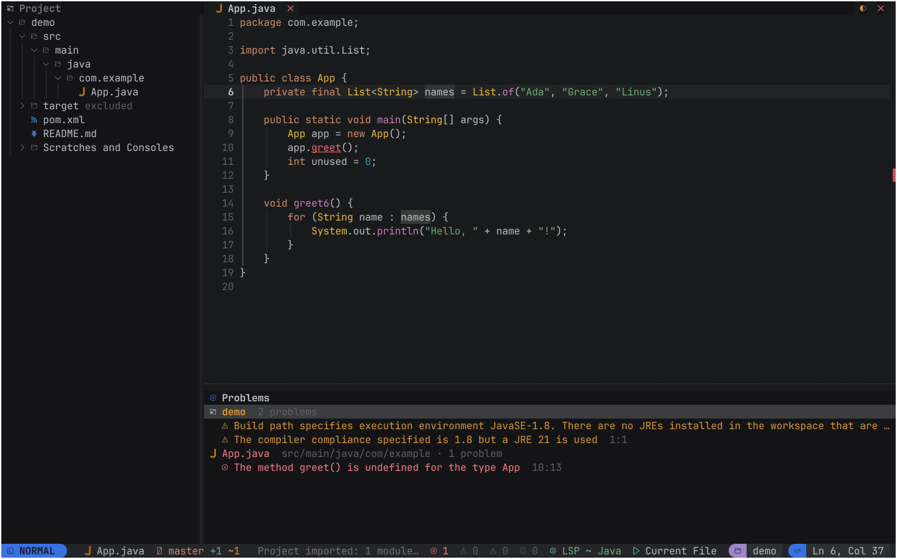
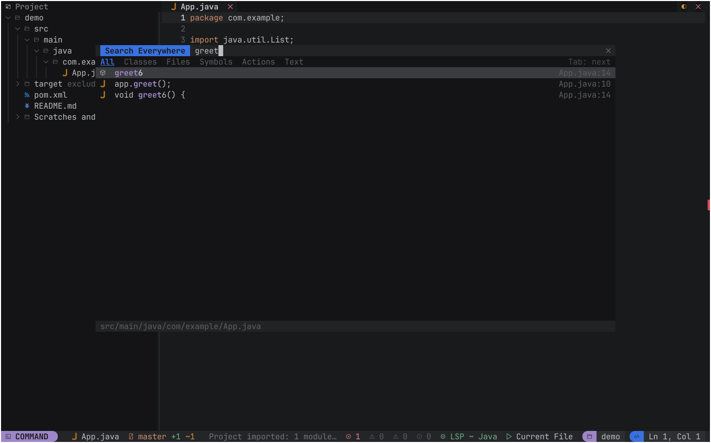

# The IDE in the terminal

`archipel-ide --tui [PROJECT_DIR] [FILE...]` starts Archipel IDE in the terminal instead of a
window. It is the same binary and the same IDE core as the GUI (no separate package, no
display, no GPU); only the frontend differs. The frontend is the crate
`crates/archipel-ide-tui`, built on `archipel-kit-tui` (the terminal edition of the UI kit,
ratatui 0.30). **The TUI mirrors the GUI**: it looks and behaves exactly like the IntelliJ-like
window frontend (`crates/archipel-ide-ui`), drawn with terminal cells: the same main toolbar and main
menu, tool window stripes, tool window headers, editor tabs, gutter, status bar, popups and dialogs, the
same Islands Dark theme, the same commands, actions and default shortcuts, all reachable with the mouse.
Both frontends render one shared UI layer. The binding design is
`docs/specs/tui/01-gui-faithful-terminal-ui.md` (what the terminal shows) and
`docs/specs/tui/02-shared-component-layer.md` (how the two frontends share the UI); the work plan is
Wave 0 of `docs/tui-parity.md`. Sections below that describe the earlier NvChad-style design (no menu, no
toolbar, no stripes, `Ctrl+K` chords, a mode indicator) are marked "being replaced" until Wave 0 lands.

```bash
archipel-ide --tui .                  # open the current folder
archipel-ide --tui . src/main.rs      # and a file
archipel-ide --tui                    # no project: press O to open a folder
```

Use a terminal with 24-bit color and a [Nerd Font](https://www.nerdfonts.com) (JetBrainsMono
Nerd Font, the plain variant): all icons are Nerd Font characters. WezTerm, kitty, Ghostty,
iTerm2, Windows Terminal, Alacritty and GNOME Terminal work; a terminal with the kitty keyboard
protocol also delivers the combinations a legacy terminal cannot send (see "Keys").

## Layout (being replaced, see docs/specs/tui/01-gui-faithful-terminal-ui.md sections B to H)

This describes the current build, not the target: the target has the GUI's toolbar on row 0, stripes,
tool window headers, a tab strip with icons and close buttons, breadcrumbs and the GUI's status bar, and no
mode indicator.

```
 Project                    Main.java ●  README.md                                  󰖨  󰅖
  demo                     │    1 package demo;
  ├─ src                   │    2
  │  └─ Main.java          │    3 public class Main {
  └─ README.md             │    4 │   public static void main(String[] args) {
                           │    5 │   │   System.out.println("hi");
                           │    6 │   }
                           │    7 }
                           │─────────────────────────────────────────────────────────────
                           │  Run
                           │  $ cargo run
  INSERT  Main.java  main +1 ~2   0  1  0  0   LSP Java   demo ▸ app   demo   Ln 5, Col 9
```

- **Left**: the Project tree (Alt+1) or the Commit window (Alt+0).
- **Top row**: the tab line (one tab per open document; a dot marks unsaved changes).
- **Middle**: the editor, or the dashboard while no file is open.
- **Bottom**: one of Run (Alt+4), Problems (Alt+6), Find (Alt+3) or Terminal (Alt+F12).
- **Last row**: the status line: mode, file, Git branch and change counts, the status message
  (or indexing and run progress), the problem counts of the file, the language server, the
  selected run configuration (click it to choose), the project and the caret position.

(Being replaced: the new layout has a toolbar, a main menu and stripes; see the spec.) The mouse works
everywhere (tabs, tree, lists, tool window titles, splitters, status line segments).

## Screenshots

Taken with `archipel-ide --tui` in xterm (JetBrainsMono Nerd Font Mono, 24-bit color).

The editor with the Project tree: an error is a red underline on the range (no background),
the selected text and its other occurrences have a subtle background.



The Problems window (Alt+6): problems that belong to no file, such as the build path and the
compiler compliance, are grouped under the project's name; the others under their file.



Search Everywhere (double Shift, or Ctrl+K then E):



## Terminal notes

- **Diagnostics** are drawn as curly underlines (SGR `4:3`) in the severity color on kitty,
  WezTerm, Ghostty, Alacritty, foot, iTerm2, Windows Terminal and VTE terminals (GNOME
  Terminal); `ARCHIPEL_UNDERCURL=1` or `=0` forces it. Other terminals, xterm included, get a
  plain underline in the severity color. Never a background: errors are red, warnings yellow,
  weak warnings subtle.
- **xterm**: Alt shortcuts (Alt+1, Alt+6, Alt+Enter) need `XTerm*metaSendsEscape: true` in
  `~/.Xresources` (or `-xrm 'XTerm*metaSendsEscape: true'`); without it xterm types the
  character with the eighth bit set, so Alt+6 inserts `¶`. Also use `XTerm*directColor: true`
  and a UTF-8 locale (`LANG=C.UTF-8`) for the colors and the icons.

## Keys (being replaced, see docs/specs/tui/01-gui-faithful-terminal-ui.md section L and appendix B)

The shortcuts are the GUI keymap. The `Ctrl+K` and `Ctrl+W` fallback chords of the table below are
superseded: every action will be reachable through the menu bar, toolbar and stripes first, keys a legacy
terminal cannot send get alternatives behind the single leader `Ctrl+\` (none shadows a GUI shortcut), and
the kitty keyboard protocol is detected with a one-time notice.

The shortcuts are the active keymap of the IDE (Settings | Keymap in the GUI, the default
`$default` keymap otherwise, user overrides included): the frontend resolves key presses with
the same action ids and asks the same action registry the GUI does. Where a terminal cannot
send a combination, `Ctrl+K` followed by a letter does the same; with the kitty keyboard
protocol both work.

| Action | Shortcut | Terminal without kitty protocol |
|---|---|---|
| Search Everywhere | Double Shift | Ctrl+K then E (double Shift needs the kitty protocol) |
| Find Action | Ctrl+Shift+A | Ctrl+P, Ctrl+K then A |
| Go to File | Ctrl+Shift+N | Ctrl+K then N |
| Go to Line:Column | Ctrl+G | |
| Recent Files / Switcher | Ctrl+E, Ctrl+Tab | Ctrl+K then T (the Switcher shows Recent Files) |
| Find in Files | Ctrl+Shift+F | Ctrl+K then F |
| Find, Replace, Next | Ctrl+F, Ctrl+R, F3 | |
| Save All | Ctrl+S | |
| Go to Declaration | Ctrl+B | Ctrl+K then B |
| Back / Forward | Ctrl+Alt+Left / Right | Ctrl+K then [ / ] |
| Code Completion | Ctrl+Space | Ctrl+K then Space |
| Context actions and quick fixes | Alt+Enter | Ctrl+K then Enter |
| Next / previous problem | F2, Shift+F2 | |
| Run, Stop, Rerun | Shift+F10, Ctrl+F2, Ctrl+F5 | |
| Choose run configuration | Alt+Shift+F10 | click the run segment in the status line |
| Project, Find, Run, Problems | Alt+1, Alt+3, Alt+4, Alt+6 | Ctrl+W then the digit |
| Commit window | Alt+0 | Ctrl+K then C |
| Terminal | Alt+F12 | |
| Hide window, hide all, jump back | Shift+Esc, Ctrl+Shift+F12, F12 | Ctrl+W then H |
| Previous / next tab, close tab | Alt+Left / Alt+Right, Ctrl+F4 | Ctrl+K then W |
| Quit (saves everything first) | Exit in Find Action | Ctrl+K then Q |

The editor takes the keys of the IDE editor (multiple carets with Alt+J, duplicate line with
Ctrl+D, move line with Alt+Shift+Up/Down, comment with Ctrl+/, folding, undo and redo and
so on). A chord shows a which-key list after its first stroke: press Ctrl+K and wait to see
the fallbacks.

In the popups: Up/Down move, Enter chooses, Esc closes, Tab switches the tabs of Search
Everywhere (All, Classes, Files, Symbols, Actions, Text). In the completion popup Enter inserts
the item and Tab replaces the identifier. In the Commit window Space checks a file, `c` opens
the commit dialog and `r` refreshes. In the Terminal window every key goes to the shell except
the window and Find Action keys above.

## What works (current build)

- **Project**: the folder opens through the same `project.open` command as the GUI, so the
  project model import (Gradle, Maven, Cargo, Bazel), the indexes, the language servers and the
  toolchain checks start the same way (missing toolchains install in the background unless
  `ARCHIPEL_NO_TOOLCHAIN_SETUP` is set). The tree shows the project view of the core with
  compact packages, source roots and libraries.
- **Editor**: open, edit and save through the core's document model; Save All (Ctrl+S), save on
  focus loss (the "save when switching to another application" setting) and on exit. Syntax
  highlighting comes from the core's analysis (tree-sitter, mapped to the editor colors).
  Diagnostics from the daemon (parse errors, native inspections, language server) are drawn as
  squiggles with a message on hover, and listed in Problems with the counts in the status line.
- **Intentions**: Alt+Enter opens the quick fixes and intentions of the core at the caret.
  **Completion**: the core's completion session (language servers and native providers) as a
  popup at the caret; typing opens it automatically. **Go to Declaration**, Back and Forward use
  the core's navigation history.
- **Navigation**: Go to File, Search Everywhere (classes, symbols, actions, text) and Find
  Action rank like the GUI (`quick_nav`); actions are the registry's, with their presentation
  (enabled, text) and the keymap's shortcut. Find in Files shows its results in the Find window.
- **Run**: the run configurations of the project (`.archipel/runConfigurations`, detected
  Cargo, Gradle, Maven, npm and Go targets). Run, Stop and Rerun go through the core, the
  console, the build output and test output appear in the Run window, and a line with a
  source location opens the file (Enter or double click).
- **Git**: the branch and change counts in the status line, the Commit window with changed and
  unversioned files, and Commit with a message for the checked files.
- **Terminal**: a pseudo-terminal session (the core's `terminal.*` commands) drawn in the window.

## How it is built

`archipel-ide-tui` owns no project, document or run state. `Ide` wraps the core
(`IdeState`, the command registry and the action registry) and does what the GUI frame does:
poll the services, sync plugin commands, ask `DataContext` and `AnAction` for presentations and
effects. Key presses resolve to action ids in the kit's runtime (the IDE keymap is layered on
the kit's terminal keymap) and run through `ActionRegistry::perform`; the frontend only handles
the effects it has to render (dialogs, pickers).

Editing is the core's, exactly as in the GUI. A typed character is `editor.type` (pairs,
overtype, surround, live templates, completion and parameter info follow), every other editor key
is an action of the keymap (`EditorEnter`, `EditorBackSpace`, `EditorTab`, the caret keys, Duplicate
Line, Move Line, folding, Undo, ...) that runs the same typed command the GUI runs
(`editor.action`, `editor.enter`, `editor.duplicate`, ...), and a bracketed paste is `editor.paste`.
The kit's editor widget (`archipel-kit-tui`) only draws: each open document has a `DocView` whose
editor model is a picture of the core document, refreshed after every change: the text, every
caret and selection (several carets work) and the fold regions come from the core. What the
widget does itself goes back as core commands: a click or drag becomes `editor.setSelections`, a
fold chevron `editor.toggleFold`, and the Replace of the widget's find bar `editor.replaceRange`.
The widget's find bar (Ctrl+F, Ctrl+R, F3) is the only part of it that still takes keys. Undo and
redo are the core's history, copy and cut go through `editor.copy` and `editor.cut` to the
terminal clipboard (OSC 52).

## Known limitations (current build)

- **Not available yet** (the command says so in the status line): the debugger, Rename and the
  other refactoring dialogs, Generate, Settings, the diff viewer and Local History, plugin
  views (plugin commands work), Android tooling, the AI assistant and Agents mode, the Git log,
  branches and push. Use the GUI for these.
- Editor splits are shown as one tab list. Long lines wrap (the widget cannot follow a caret
  horizontally). Documents with CRLF line endings are drawn as LF and keep CRLF in the core.
  Shift+arrows in column selection mode do not extend the block yet (the mode toggles).
- Keys a terminal cannot send have fallbacks: Alt+Up / Alt+Down extend and shrink the selection
  (Ctrl+W leads the window chords), Ctrl+7 comments (Ctrl+/), Ctrl+H deletes a word, and the
  region, occurrence and caret actions of the editor are `Ctrl+K` chords (see the which-key list).
- Quick Documentation, parameter info and inlay hints have no terminal surface yet.
- Double Shift needs a terminal that reports modifier keys (kitty protocol); on macOS Option+digit
  types a symbol, so use Ctrl+W then the digit there.
- On Windows the release binary is a GUI-subsystem program; `--tui` attaches to the console of
  the parent process, so start it from Windows Terminal or `cmd`, not by double click.
- Being replaced: the look is the dark Nerd Font NvChad look, the tab line's sun button (or Find Action |
  Switch Theme) cycles the kit's themes, and colors do not follow the GUI's theme setting. The target is
  the GUI's theme mapped to 24-bit color (spec section I).

## Tests

`cargo test -p archipel-ide-tui` drives the real IDE core against ratatui's `TestBackend`
(no terminal, no GPU): the layout renders, a fixture project opens, typing and saving reach the
file (and a lost terminal focus saves), syntax colors come from the analysis, the daemon
reports a diagnostic and Alt+Enter applies the quick fix, Find Action, Go to File and Recent
Files, Find in Files, tab clicks, the project tree (open, New File, Delete), a shell run
configuration prints its output and Stop ends a running task, completion and Go to
Declaration with Back and Forward against the scriptable fake language server
(`archipel-fake-lsp`, built by `cargo test --workspace`; those tests are skipped when it is
missing), the Commit window against a temporary Git repository, and the Terminal window
against a real shell. `tests/editor_cases.rs` replays the editor spec cases
(`docs/specs/editor/cases/`, the same files, parser and judgement as the core's runner) through the
TUI's key events, typed characters and paste events and reads the result from the core document:
it must pass exactly what the core's runner passes (341 cases). Unit tests cover the editor/core
mirror (offsets, CRLF, carets, folds, find-bar replace), the tree nesting, the keymap layering and
the shell key bytes.
