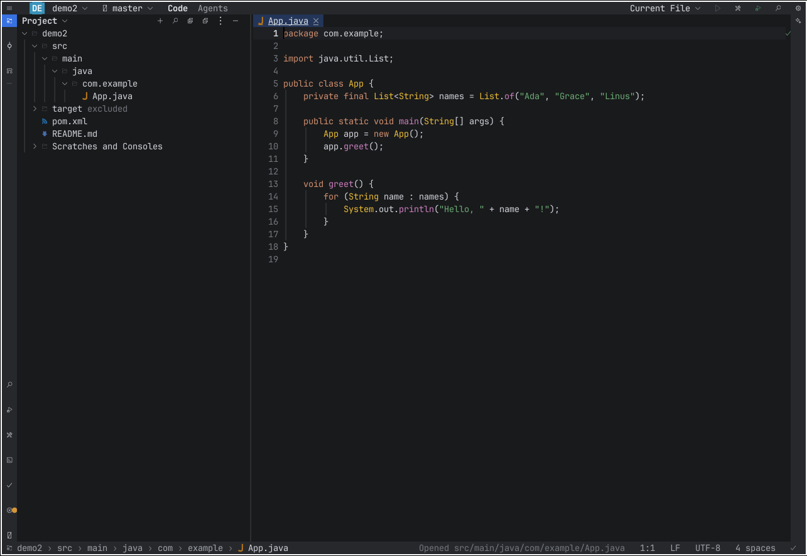
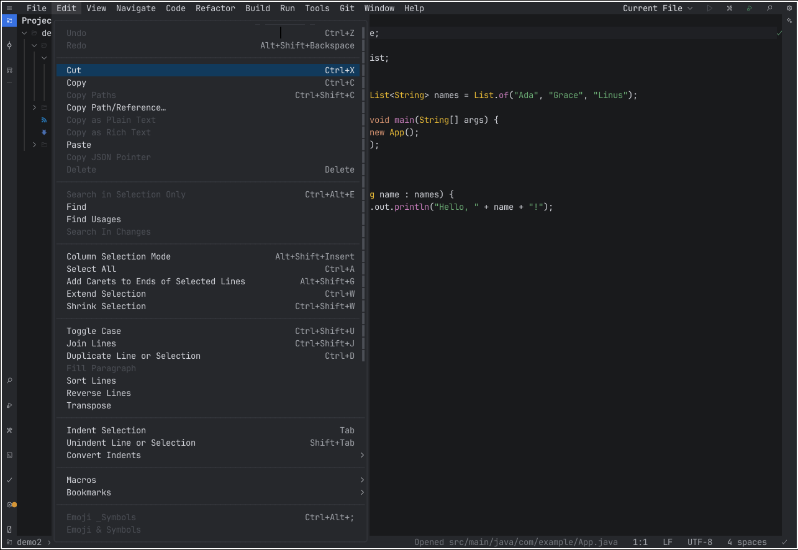
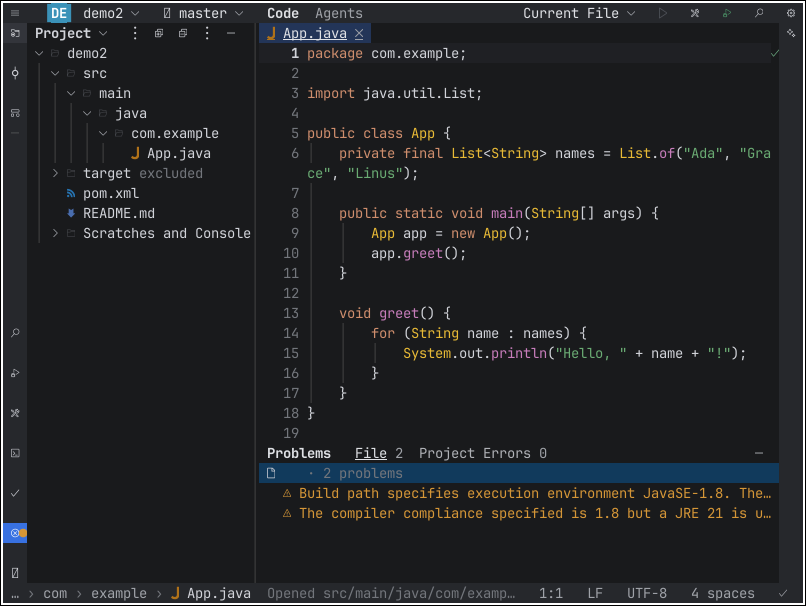
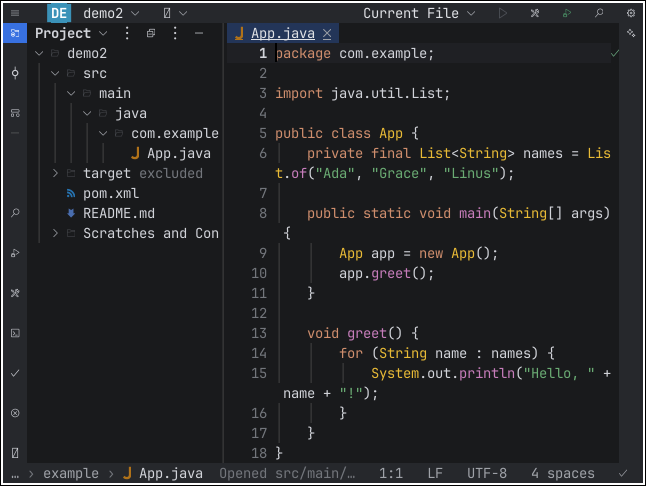

# The IDE in the terminal

`archipel-ide --tui [PROJECT_DIR] [FILE...]` starts Archipel IDE in the terminal instead of a
window. It is the same binary and the same IDE core as the GUI (no separate package, no
display, no GPU); only the frontend differs. The frontend is the crate
`crates/archipel-ide-tui`, built on `archipel-kit-tui` (the terminal edition of the UI kit,
ratatui 0.30). **The TUI mirrors the GUI**: it looks and behaves exactly like the IntelliJ-like
window frontend (`crates/archipel-ide-ui`), drawn with terminal cells: the same main toolbar and main
menu, tool window stripes, tool window headers, editor tabs, gutter, status bar, popups and dialogs, the
same Islands Dark theme, the same commands, actions and default shortcuts, all reachable with the mouse.
Both frontends render one shared UI layer. The binding design is
`docs/specs/tui/01-gui-faithful-terminal-ui.md` (what the terminal shows) and
`docs/specs/tui/02-shared-component-layer.md` (how the two frontends share the UI); the work plan is
Wave 0 of `docs/tui-parity.md`. Phases 0.1 (shared model and test infrastructure) and 0.2 (the chrome:
toolbar, main menu, stripes, headers, tabs, status bar, keys) are in; dialogs, popups and tool window
bodies still use the older components in the GUI's colors and move over in phases 0.3 to 0.5.

```bash
archipel-ide --tui .                  # open the current folder
archipel-ide --tui . src/main.rs      # and a file
archipel-ide --tui                    # no project: File | Open…
```

Use a terminal with 24-bit color and a [Nerd Font](https://www.nerdfonts.com) (JetBrainsMono
Nerd Font, the plain variant): all icons are Nerd Font characters. WezTerm, kitty, Ghostty,
iTerm2, Windows Terminal, Alacritty and GNOME Terminal work; a terminal with the kitty keyboard
protocol also delivers the combinations a legacy terminal cannot send (see "Keys").

## Layout

The terminal draws the GUI's window with terminal cells (spec `docs/specs/tui/01-gui-faithful-terminal-ui.md`,
sections B to H). One shared model builds every part of it, `archipel-ide-view::Chrome`, and the kit's
terminal components (`archipel-kit-tui`: `ToolbarControl`, `MenuBarControl`, `ToolStripeControl`,
`PanelHeaderControl`, `TabBarControl`, `StatusItemsControl`) draw it with the Islands Dark colors of the
GUI theme as 24-bit color (`Look::gui`). The terminal never decides what an item says, whether it is
enabled, or which shortcut it shows: that is the model's.



- **Row 0** is the main toolbar: the hamburger (click it to expand the main menu: File, Edit, View,
  Navigate, Code, Refactor, Build, Run, Tools, Git, Window, Help), the project widget with its avatar, the
  VCS branch widget, the Code and Agents mode switch, and on the right the run widget (run
  configuration popup, Run, Build, Debug, Stop), Search Everywhere and Settings. Every widget opens what
  the GUI opens.
- **Stripes**: three cells on the left and the right with the tool window buttons of the GUI (Project,
  Commit, Structure above; Find, Run, Build, Terminal, Problems, Git below), the active window filled with
  the accent color, a badge for errors and warnings. Click a button to toggle its window; hovering shows
  the GUI's tooltip with the shortcut.
- **Tool windows** have the GUI's one-row header: title or view selector, actions (a `⋮` overflow when
  they do not fit) and the Hide button. Left, right and bottom windows are separated by one-cell
  splitters you can drag; sizes are in cells.
- **Editor column**: the tab strip (file icons, a dot for unsaved changes, `✕` on the selected tab and on
  hover, middle click closes), the editor with gutter, soft wrap and the error stripe in the last column.
- **Last row**: the status bar: breadcrumbs on the left, then the status message and the widgets
  (caret position, line separator, encoding, indent, indexing, language servers). Widgets drop by priority
  when the width is short.

Smaller terminals keep the same elements and drop the lowest priority ones: the Code/Agents switch and
widget labels first, then stripe-side widgets, then status bar widgets. Below 60x16 only a message
is shown.







## Keys

The shortcuts are the active keymap of the IDE (Settings | Keymap in the GUI, the default `$default`
keymap otherwise, user overrides included): the frontend resolves key presses with the same action ids and
asks the same action registry the GUI does. Every action is also reachable with the mouse from the menu bar,
toolbar, stripes, headers, context menus or Search Everywhere (`archipel-ide-view` test `reachability`).

A terminal with the **kitty keyboard protocol** (kitty, WezTerm, foot, Ghostty, Alacritty 0.13+) sends
every GUI shortcut, including Ctrl+Shift+letter and double Shift. A **legacy terminal** cannot send some
of them (Ctrl+Shift+letter, Ctrl+Alt+arrow, Ctrl+Space on some terminals). For those the single leader
**`Ctrl+\`** followed by a key does the action; a chord never replaces a GUI shortcut and none of them is
bound in a shipped keymap (`archipel-ide-view` test `keys_collisions`; where a keymap such as VSCode binds
`Ctrl+\` the leader falls back to `Ctrl+]`, then `Ctrl+^`). The first start in a legacy terminal shows a
one-time notice; Help | Terminal Keyboard Setup… shows it again. The table is
`archipel_ide_view::keys::CHORDS`; the main rows:

| Action | GUI shortcut | Chord |
|---|---|---|
| Search Everywhere | Double Shift (kitty only) | Ctrl+\ then E |
| Find Action | Ctrl+Shift+A | Ctrl+\ then A |
| Go to File | Ctrl+Shift+N | Ctrl+\ then N |
| Find in Files | Ctrl+Shift+F | Ctrl+\ then F |
| Redo | Ctrl+Shift+Z | Ctrl+\ then Z |
| Back / Forward | Ctrl+Alt+Left / Right | Ctrl+\ then [ / ] |
| Close tab | Ctrl+F4 | Ctrl+\ then W |
| Commit window | Alt+0 | Ctrl+\ then 0 |
| Project, Find, Run, Problems | Alt+1, Alt+3, Alt+4, Alt+6 | Ctrl+\ then the digit |
| Terminal | Alt+F12 | Ctrl+\ then F12 |
| Hide all windows | Ctrl+Shift+F12 | Ctrl+\ then H |
| Extend / Shrink Selection | Ctrl+W, Ctrl+Shift+W | Ctrl+W works; Ctrl+\ then shift W |
| Context actions and quick fixes | Alt+Enter | Ctrl+\ then Enter |
| Quit (saves everything first) | Exit in the File menu | Ctrl+\ then Q |

A chord shows a which-key list after its first stroke. In the popups: Up/Down move, Enter chooses, Esc
closes, Tab switches the tabs of Search Everywhere. In the Terminal window every key goes to the shell
except the window and Find Action keys; Esc in another tool window returns to the editor.

**Closing and quitting never lose edits**: closing a tab or quitting saves the modified documents first
(as the GUI does on close) and asks only when a document cannot be saved. A disabled command is greyed in
its menu and does nothing when its key is pressed; the terminal never shows a command id.

**Mouse**: every button, widget, stripe button, header action, tab, menu row, splitter and list row works as
in the GUI. Hover shows the GUI's tooltips after 500 ms; submenus open after 250 ms; right click opens the
context menus of the editor, tabs and the project tree.

Glyphs: `ARCHIPEL_TUI_GLYPHS=ascii` draws ASCII stand-ins for every Nerd Font icon with the same geometry.
Without `COLORTERM=truecolor` the colors are quantized to the 256-color cube.

## What works (current build)

- **Project**: the folder opens through the same `project.open` command as the GUI, so the
  project model import (Gradle, Maven, Cargo, Bazel), the indexes, the language servers and the
  toolchain checks start the same way (missing toolchains install in the background unless
  `ARCHIPEL_NO_TOOLCHAIN_SETUP` is set). The tree shows the project view of the core with
  compact packages, source roots and libraries.
- **Editor**: open, edit and save through the core's document model; Save All (Ctrl+S), save on
  focus loss (the "save when switching to another application" setting) and on exit. Syntax
  highlighting comes from the core's analysis (tree-sitter, mapped to the editor colors).
  Diagnostics from the daemon (parse errors, native inspections, language server) are drawn as
  squiggles with a message on hover, and listed in Problems with the counts in the status line.
- **Intentions**: Alt+Enter opens the quick fixes and intentions of the core at the caret.
  **Completion**: the core's completion session (language servers and native providers) as a
  popup at the caret; typing opens it automatically. **Go to Declaration**, Back and Forward use
  the core's navigation history.
- **Navigation**: Go to File, Search Everywhere (classes, symbols, actions, text) and Find
  Action rank like the GUI (`quick_nav`); actions are the registry's, with their presentation
  (enabled, text) and the keymap's shortcut. Find in Files shows its results in the Find window.
- **Run**: the run configurations of the project (`.archipel/runConfigurations`, detected
  Cargo, Gradle, Maven, npm and Go targets). Run, Stop and Rerun go through the core, the
  console, the build output and test output appear in the Run window, and a line with a
  source location opens the file (Enter or double click).
- **Git**: the branch and change counts in the status line, the Commit window with changed and
  unversioned files, and Commit with a message for the checked files.
- **Terminal**: a pseudo-terminal session (the core's `terminal.*` commands) drawn in the window.

## How it is built

`archipel-ide-tui` owns no project, document or run state. `Ide` wraps the core
(`IdeState`, the command registry and the action registry) and does what the GUI frame does:
poll the services, sync plugin commands, ask `DataContext` and `AnAction` for presentations and
effects.

The chrome is the shared layer (spec file 02): `archipel-kit-model` (kit repo) holds the component
vocabulary as plain data (`Toolbar`, `MenuBar`, `ToolStrip`, `PanelHeader`, `TabBar`, `StatusBar`,
`Breadcrumbs`, `Shortcut`, `Tooltip`) with stable ids and semantic tones, and `archipel-ide-view` (this repo)
builds those props from the core: `Chrome::build`, `context_menu`, the toolbar popups, and
`dispatch(Event) -> Vec<Effect>`, which turns a component event into commands, actions and the surfaces
a frontend opens. Neither crate depends on egui or ratatui. `archipel-ide-tui` places the kit controls
(`chrome.rs`), keeps the focus and the splitters (`shell.rs`) and applies the effects (`app.rs`).
Key presses resolve to action ids in the kit's runtime (the IDE keymap plus the chord table of
`archipel_ide_view::keys`) and run through `ActionRegistry::perform`; the frontend only handles the
effects it has to render (dialogs, pickers) and the window layout actions (hide, jump, maximize, resize).

Editing is the core's, exactly as in the GUI. A typed character is `editor.type` (pairs,
overtype, surround, live templates, completion and parameter info follow), every other editor key
is an action of the keymap (`EditorEnter`, `EditorBackSpace`, `EditorTab`, the caret keys, Duplicate
Line, Move Line, folding, Undo, ...) that runs the same typed command the GUI runs
(`editor.action`, `editor.enter`, `editor.duplicate`, ...), and a bracketed paste is `editor.paste`.
The kit's editor widget (`archipel-kit-tui`) only draws: each open document has a `DocView` whose
editor model is a picture of the core document, refreshed after every change: the text, every
caret and selection (several carets work) and the fold regions come from the core. What the
widget does itself goes back as core commands: a click or drag becomes `editor.setSelections`, a
fold chevron `editor.toggleFold`, and the Replace of the widget's find bar `editor.replaceRange`.
The widget's find bar (Ctrl+F, Ctrl+R, F3) is the only part of it that still takes keys. Undo and
redo are the core's history, copy and cut go through `editor.copy` and `editor.cut` to the
terminal clipboard (OSC 52).

## Known limitations (current build)

- **Not available yet** (the command says so in the status line): the debugger, Rename and the
  other refactoring dialogs, Generate, Settings, the diff viewer and Local History, plugin
  views (plugin commands work), Android tooling, the AI assistant and Agents mode, the Git log,
  branches and push. Use the GUI for these.
- Editor splits are shown as one tab list. Long lines wrap (the widget cannot follow a caret
  horizontally). Documents with CRLF line endings are drawn as LF and keep CRLF in the core.
  Shift+arrows in column selection mode do not extend the block yet (the mode toggles).
- Keys a terminal cannot send have chords behind `Ctrl+\` (see "Keys"); Ctrl+7 comments (Ctrl+/) and
  Ctrl+H deletes a word in a legacy terminal.
- Quick Documentation, parameter info and inlay hints have no terminal surface yet.
- Double Shift needs a terminal that reports modifier keys (kitty protocol); on macOS Option+digit
  types a symbol, so use `Ctrl+\` then the digit there.
- On Windows the release binary is a GUI-subsystem program; `--tui` attaches to the console of
  the parent process, so start it from Windows Terminal or `cmd`, not by double click.
- The theme follows the Settings theme (default Islands Dark) live. Dialogs, popups and the
  tool window bodies other than the Project tree still use the older kit components drawn in the GUI's
  colors; phases 0.3 to 0.5 replace them with the shared models (the Welcome screen, Search
  Everywhere, Find in Files, completion and the dialogs). Sizes of the splitters are not saved yet
  (`tui.*` settings), and the one-time keyboard notice is remembered in
  `$XDG_CONFIG_HOME/archipel-ide/tui-keyboard-notice` instead of the user settings.

## Tests

`cargo test -p archipel-ide-tui` drives the real IDE core against ratatui's `TestBackend`
(no terminal, no GPU): the layout renders, a fixture project opens, typing and saving reach the
file (and a lost terminal focus saves), syntax colors come from the analysis, the daemon
reports a diagnostic and Alt+Enter applies the quick fix, Find Action, Go to File and Recent
Files, Find in Files, tab clicks, the project tree (open, New File, Delete), a shell run
configuration prints its output and Stop ends a running task, completion and Go to
Declaration with Back and Forward against the scriptable fake language server
(`archipel-fake-lsp`, built by `cargo test --workspace`; those tests are skipped when it is
missing), the Commit window against a temporary Git repository, and the Terminal window
against a real shell. The Wave 0 tests:

- `chrome_parity` (TUI-GUI-191, 192): for six fixtures (no project, a Java project with a dirty tab,
  macOS notation, an Android project, indexing, a running task) at 160x45, 100x30 and 80x24, the outline
  read back from the screen cells equals the outline of the `archipel-ide-view` props (items, order,
  labels, enabled state, shortcuts, tooltips; narrow screens drop items by priority, never alter them), and
  all twelve menus are opened to their deepest submenu and compared row by row.
- `theme_tokens` (TUI-GUI-120, 121): surfaces, the selected tab, the splitters and popups use the tokens of
  `Theme::colors`; a translucent token is blended over its surface; the Settings theme re-themes live.
- `ascii_geometry` (TUI-GUI-131, 132), `keys_table` (TUI-GUI-194), `keyboard_notice` (TUI-GUI-159, 045),
  `unsaved_edits` (closing and quitting never lose edits; disabled commands stay silent).
- In `archipel-ide-view`: `reachability` (TUI-GUI-193), `keys_collisions` (TUI-GUI-170), `chrome_view`
  (composition, order, enabled state), `no_ui_deps` (neither toolkit in the dependency tree).

`tests/editor_cases.rs` replays the editor spec cases
(`docs/specs/editor/cases/`, the same files, parser and judgement as the core's runner) through the
TUI's key events, typed characters and paste events and reads the result from the core document:
it must pass exactly what the core's runner passes (341 cases). Unit tests cover the editor/core
mirror (offsets, CRLF, carets, folds, find-bar replace), the tree nesting, the keymap layering and
the shell key bytes.
